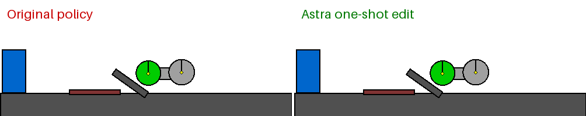

# Weight-Space Programming on Snowflake

> In Weight-Space Programming, a general-purpose LLM reads and writes a network’s weights directly (i.e., not through an optimizer, and in particular not with gradient descent) around some natural language spec, sometimes even with no environment feedback at all.
>
> — [Sparks of Weight-Space Programming](https://rikiyat.github.io/blog/weight-space-programming/), Takehi, Teoh, Zhang, and Khattab (MIT CSAIL)

This repository reproduces the paper's car-repair experiment on Snowflake. GPT-6 Astra, called through the [Snowflake Cortex REST API](https://docs.snowflake.com/en/user-guide/snowflake-cortex/cortex-rest-api), reads the weights of a failing control policy and writes new ones in a single reply.



<sub>Episode 0 of our evaluation, rendered with [Kinetix](https://github.com/FLAIROx/Kinetix). Left: the trained policy. Right: Astra's edit.</sub>

## What it is

Today, in the paper's words, "weights are written by optimization, by custom networks trained to write them, or by compilers from formal programs." We already use LLMs to improve prompts, programs, and training code. Weights stayed out of reach because people can't optimize them by hand.

The paper argues that "the paradigm of reasoning-driven optimization is now coming even for differentiable neural networks." Astra does not run a training loop. "It uses its reasoning to figure out what each part of a neural network computes, or should compute, and changes the weights accordingly."

## Why it's useful

The paper reports three capabilities:

- **Reading:** "Just by looking at the raw weights, GPT-6 Astra can tell what a network was trained to do."
- **Fixing:** asked to improve Qwen3.5-0.8B at math without gradients, Astra edits 0.016% of the weights and raises MATH-500 from 7.9% to 48.1%.
- **Writing:** "without any environment feedback, it has no trouble writing, from scratch, small game-playing networks that outplay networks trained with PPO for 100 million steps."

If the results hold up, failures can be diagnosed and repaired directly in the weights, with no new data or retraining. The authors suggest this "might be a big deal for both optimization and interpretability."

## The car experiment

From the paper's Experiment 4: "We train a PPO network to operate a car such that it can scale a ramp in a Kinetix environment. To do so, it needs to reverse the car for some distance... However, the PPO network converges to a local-minimum policy where it drives straight at the ramp and gets stuck."

The paper reports: "In a single try with no tools, Astra’s edit makes the car succeed in all 1,024 episodes, changing 3.5% of the weights."

| | Paper | This reproduction |
|---|---|---|
| Network | 679 → 128 → 5×128 → 16, 171,664 weights | Same |
| Programmer | GPT-6 Astra, one reply, no tools | GPT-6 Astra via Cortex REST, one reply, no tools |
| Original policy | 0 successes | 0 / 1,024 |
| Astra's edit | 1,024 / 1,024, 3.5% of weights | 1,024 / 1,024, 4.3% of weights |

With the paper's prompt alone, Astra's edit did not solve the task: 0 / 1,024. It nudged the policy toward a single action preference, so the car either still stalled or reversed into the red strip. The car has to act differently depending on where it is: reverse first, then drive forward once it has enough runway. Telling Astra to think of the policy as a state-dependent controller solved it. We put one instruction in front of the paper's prompt:

> Consider whether the repair requires different actions in different physical states rather than a constant action preference. Define the conditions using the available observations, map those conditions through the network’s activations, and check the signs and thresholds of your proposed numerical edits. You must determine the weights yourself.

With that instruction, Astra's single reply changed 7,326 weights, and the car succeeded in all 1,024 episodes. Astra never saw the published solution or any evaluation result.

Our evaluator is a reconstruction of the paper's setup, not a bit-exact copy. The upstream prompt, weights, and published answer have no declared license, so they aren't included here.

## On Snowflake

- Astra runs through the [Cortex REST API](https://docs.snowflake.com/en/user-guide/snowflake-cortex/cortex-rest-api).
- Policy evaluation runs locally on CPU with JAX and [Kinetix](https://github.com/FLAIROx/Kinetix), pinned to commit `80ee9c2`.

Results: [car-weight-edit](results/car-weight-edit/README.md). Runner: [`scripts/car_guided_experiment.py`](scripts/car_guided_experiment.py).

## Run it

Put the upstream prompt, checkpoint, and pinned Kinetix source in `artifacts/car-oneshot/source/`. They come from [RikiyaT/lm_understand-logs](https://github.com/RikiyaT/lm_understand-logs) and [Kinetix](https://github.com/FLAIROx/Kinetix), and are not redistributed here.

```bash
uv venv --python 3.11 .venv-car
uv pip install --python .venv-car/bin/python -r configs/car-cpu-requirements.txt -e .
.venv-car/bin/python -m pytest tests -q

export SNOWFLAKE_ACCOUNT_URL=https://<account>.snowflakecomputing.com
export SNOWFLAKE_PAT=<programmatic access token>
.venv-car/bin/python scripts/car_oneshot.py prepare
.venv-car/bin/python scripts/car_oneshot.py baseline --episodes 1024
.venv-car/bin/python scripts/car_guided_experiment.py --run-authorized-sequence
```

The final command makes one billed Astra call.

## License

[Apache 2.0](LICENSE).
